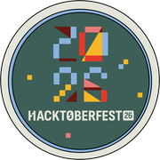
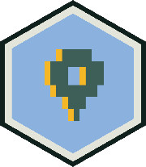

<!-- 01. HERO: CINEMATIC INTRODUCTION -->

  

<!-- 02. ABOUT ME: WHAT I BUILD & BEYOND THE CODE -->

  

<!-- 03. TECH STACK: ORBITAL UNIVERSE -->

  

<!-- 04. DEVELOPER ID & REAL-TIME DASHBOARD -->

  

<!-- 05. FEATURED PROJECTS SHOWCASE -->

  

<!-- 06. OPEN SOURCE BADGES & DEV COMMUNITY WRITING -->

  

<!-- ACCESSIBLE REPOSITORY & ARTICLE DIRECTORY -->

<strong>⚡ Core Engineering Repositories &amp; Technical Publications</strong>

 

### 🛠️ Featured Repositories ([@Neet2516 Repositories](https://github.com/Neet2516?tab=repositories))

| Repository | Domain / Focus | Key Architecture &amp; Tech Stack | Links |
| :--- | :--- | :--- | :--- |
| **[DevFlow](https://github.com/Neet2516/Devflow)** *(12 ★)* | Distributed CI/CD | Node.js, TypeScript, Express, BullMQ, Redis Streams, PostgreSQL, Docker | [Source](https://github.com/Neet2516/Devflow) · [Docs](https://docs-devflow.vercel.app) |
| **[Ghost-Hunter](https://github.com/Neet2516/Ghost-Hunter)** | Air-Gapped Sentinel | TypeScript, Temporal Workflow, Local Gemma 3 LLM, Air-Gapped Outreach | [Source](https://github.com/Neet2516/Ghost-Hunter) · [Article](https://dev.to/navneet_sinha/ghost-hunter-an-air-gapped-temporal-powered-follow-up-sentinel-with-local-gemma-3-4ok0) |
| **[PatchGarden](https://github.com/Neet2516/PatchGarden)** | AI Maintenance Ops | TypeScript, Zero-Trust Self-Healing AI, Automated Verification Testing | [Source](https://github.com/Neet2516/PatchGarden) · [Article](https://dev.to/navneet_sinha/patchgarden-i-built-an-ai-maintenance-engineer-that-doesnt-trust-its-own-patches-3jj9) |
| **[Zero-Day](https://github.com/Neet2516/Zero-Day)** *(ZeroTrace)* | Behavioral Security | TypeScript, Air-Gapped SOC Copilot, Novel Anomaly Detection | [Source](https://github.com/Neet2516/Zero-Day) · [Article](https://dev.to/navneet_sinha/zerotrace-an-air-gapped-zero-day-behavioral-soc-copilot-db2) |
| **[SyncBoard](https://github.com/Neet2516/SyncBoard)** | Real-Time Canvas | React, TypeScript, Node.js, WebSockets, Yjs CRDTs, Redis, MongoDB | [Source](https://github.com/Neet2516/SyncBoard) · [Live App](https://sync-board-client-lake.vercel.app/) |
| **[hacktoberfest-dev-4](https://github.com/Neet2516/hacktoberfest-dev-4)** | Open Source Milestone | Python, Git Automation, Verified Pull Requests &amp; Challenges | [Source](https://github.com/Neet2516/hacktoberfest-dev-4) · [Badges](#-hacktoberfest-2026--dev-community-recognition) |
| **[city-waste-command](https://github.com/Neet2516/city-waste-command)** | Circular AI Logistics | React, TypeScript, Express, Tailwind, Shadcn, Leaflet *(Top 1000 Hackathon)* | [Source](https://github.com/Neet2516/city-waste-command) |
| **[FUTURE_FS_02](https://github.com/Neet2516/FUTURE_FS_02)** *(Rust CRM)* | High-Throughput CRM | Rust, Axum, Tokio, React Client, TypeScript, REST APIs | [Source](https://github.com/Neet2516/FUTURE_FS_02) · [Live App](https://rust-crm-six.vercel.app/) |
| **[Velora-AI-agent](https://github.com/Neet2516/Velora-AI-agent)** | Autonomous Agents | TypeScript, Agentic Workflows, Tool Execution Framework | [Source](https://github.com/Neet2516/Velora-AI-agent) |
| **[octo-engine](https://github.com/Neet2516/octo-engine)** | Repo Analytics | Next.js, TypeScript, GitHub REST API, PostgreSQL, Prisma, Redis | [Source](https://github.com/Neet2516/octo-engine) |

 

### ✍️ DEV Community Technical Publications ([@navneet_sinha](https://dev.to/navneet_sinha))

> *"Software Developer passionate about open source and web technologies."*

- **[SPECTER 👻: The Ghost Maintainer](https://dev.to/navneet_sinha/specter-the-ghost-maintainer-autonomous-multi-agent-ai-system-resurrecting-abandoned-170n)** — Autonomous Multi-Agent AI System Resurrecting Abandoned Open-Source Repositories.
- **[PatchGarden 🌱: I Built an AI Maintenance Engineer That Doesn't Trust Its Own Patches](https://dev.to/navneet_sinha/patchgarden-i-built-an-ai-maintenance-engineer-that-doesnt-trust-its-own-patches-3jj9)** — Zero-trust automated codebase self-healing and verification.
- **[ZeroTrace: An Air-Gapped, Zero-Day Behavioral SOC Copilot](https://dev.to/navneet_sinha/zerotrace-an-air-gapped-zero-day-behavioral-soc-copilot-db2)** — Behavioral anomaly defense against unseen exploits in high-security environments.
- **[Ghost-Hunter: An Air-Gapped, Temporal-Powered Follow-Up Sentinel with Local Gemma 3](https://dev.to/navneet_sinha/ghost-hunter-an-air-gapped-temporal-powered-follow-up-sentinel-with-local-gemma-3-4ok0)** — Resilient outreach coordination powered by local on-device LLM inference.
- **[AuraFlora](https://dev.to/navneet_sinha/auraflora-1fh3)** — Ecological intelligence and environmental software exploration.

 

### 🎖️ Hacktoberfest 2026 &amp; DEV Community Badges

| Badge | Event &amp; Issuer | Verification |
| :---: | :--- | :--- |
|  | **Hacktoberfest 2026 Completionist** DigitalOcean × GitHub × DEV | Verified milestone completed across open-source repositories |
|  | **Hacktoberfest 2026 Challenge Completion** DEV Community Community Award | Awarded for competitive technical challenge participation |
|  | **Hacktoberfest 2026 Fest Attendee** DigitalOcean Open Source | Global attendee celebrating open software ecosystems |
|  | **DEV.to Writing Debut** DEV Community Author Badge | Recognized author for in-depth engineering breakdowns |

 

<!-- 07. GITHUB CONTRIBUTION CITY: 3D METROPOLIS -->

  

  Night skyline automatically refreshed daily via <a href=".github/workflows/contribution-city.yml">GitHub Actions</a> and <code>yoshi389111/github-profile-3d-contrib</code>.

<!-- 08. CONNECT: ANIME STICKER & COMMUNICATION CHANNELS -->

  

<!-- FOOTER METADATA -->

  <a href="https://github.com/Neet2516"><strong>GitHub</strong></a> &nbsp;·&nbsp;
  <a href="https://dev.to/navneet_sinha"><strong>DEV.to</strong></a> &nbsp;·&nbsp;
  <a href="https://www.linkedin.com/in/sinha-navneet/"><strong>LinkedIn</strong></a> &nbsp;·&nbsp;
  <a href="https://portfolio-1-tofl.onrender.com/"><strong>Portfolio</strong></a> &nbsp;·&nbsp;
  <a href="mailto:getneet.25@gmail.com"><strong>Email Direct</strong></a>

  Crafted with passion in Ghaziabad, India · Midnight Crimson Design System · © 2026 Navneet Sinha

